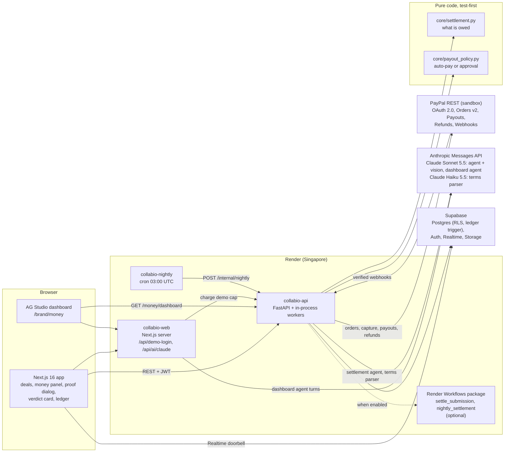

# Collabio architecture and technology deep dive

This document explains how Collabio uses **PayPal** and **Claude**, where the sponsor tools fit, and why the
design is safe to let an AI agent move money. Every claim points at the file that implements it.
The product overview and the judge guide are in [README.md](README.md).

**Contents:**
1. [System overview](#1-system-overview)
2. [PayPal integration](#2-paypal-integration)
3. [Claude (Anthropic) integration](#3-claude-anthropic-integration)
4. [Money safety: the engine, the policy and the invariants](#4-money-safety-the-engine-the-policy-and-the-invariants)
5. [Data model](#5-data-model)
6. [Frontend and the AG Studio dashboard](#6-frontend-and-the-ag-studio-dashboard)
7. [Hosting on Render](#7-hosting-on-render)
8. [Testing](#8-testing)
9. [How this maps to the judging criteria](#9-how-this-maps-to-the-judging-criteria)

---

## 1. System overview

| Piece | Where | Role |
|---|---|---|
| PayPal adapter | `backend/app/adapters/paypal.py` | REST client: OAuth, orders, capture, payouts, refunds, webhook verification |
| Money service | `backend/app/modules/money/service.py`, `repo.py`, `runner.py` | Funding, settlement runs, payouts, approvals, refunds, webhooks, nightly sweep |
| Settlement agent | `backend/app/agents/settlement_agent.py` | Claude tool-use loop with vision |
| Terms parser | `backend/app/agents/terms_parser.py` | Claude structured output: plain words → bonus terms |
| Payout engine | `backend/app/core/settlement.py` | Pure integer-cents maths: bonus, owed, payable, refund |
| Payout policy | `backend/app/core/payout_policy.py` | Pure decision: pay automatically or ask the brand |
| Payout worker | `backend/app/workers/payouts.py` | Every 30 s: resend safely, sync statuses |
| Dashboard | `frontend/components/money-dashboard/` | AG Studio sources, widgets and the "Ask Collabio" agent |
| Claude bridge | `frontend/lib/ai/claude-adapter.ts`, `frontend/app/api/ai/claude/route.ts` | AG Studio agent framework → Anthropic Messages API |

---

## 2. PayPal integration

PayPal is the only way money moves in Collabio: funding, every payout and every refund are PayPal transactions,
recorded with their PayPal IDs. The backend calls the PayPal REST API directly with `httpx` (+ `tenacity`), in
`backend/app/adapters/paypal.py`.

### 2.1 Endpoints used

| PayPal API | Endpoint | Used for |
|---|---|---|
| OAuth 2.0 | `POST /v1/oauth2/token` (client credentials) | Access tokens, minted at runtime, never stored |
| Orders v2 | `POST /v2/checkout/orders` | Fund a deal: `intent: CAPTURE`, `custom_id` = deal ID, `invoice_id`, experience context `PAY_NOW` + `NO_SHIPPING`; the buyer is redirected to the `payer-action` link |
| Orders v2 | `GET /v2/checkout/orders/{id}` | Recover an earlier approved or completed order instead of orphaning a payment |
| Orders v2 | `POST /v2/checkout/orders/{id}/capture` (`Prefer: return=representation`) | Capture on return; on `ORDER_ALREADY_CAPTURED` it reads the order back |
| Payments v2 | `POST /v2/payments/captures/{id}/refund` | Refund the unspent budget when the deal closes |
| Payouts v1 | `POST /v1/payments/payouts` | Pay the creator for one video (base + bonus), one EMAIL item, `sender_item_id` = `sender_batch_id` |
| Payouts v1 | `GET /v1/payments/payouts/{batch_id}` | Status sync: SUCCESS → `success`; FAILED, RETURNED, BLOCKED, DENIED, REFUNDED, REVERSED → `failed` |
| Webhooks | `POST /v1/notifications/verify-webhook-signature` | Verify every incoming webhook before acting on it |

### 2.2 Reliability: designed for unknown outcomes
- **Tokens:** cached in memory until 5 minutes before expiry; a `401` forces one refresh and one retry.
- **Retries:** up to 3 attempts with exponential backoff on `429/500/502/503/504` and transport errors; 30 s
  timeout.
- **Idempotency on every POST:** a `PayPal-Request-Id` that stays the same across retries, with stable IDs where
  it matters: `order-{invoice_id}`, `capture-{order_id}`, the payout's `sender_batch_id`
  (`collabio-<payout id>`, unique in the database), and `refund-{deal}-{refunded so far}-{amount}`. A timeout is
  therefore *replayed*, never *repeated*.
- **No false failures:** a network failure or `5xx` while sending a payout leaves it `approved` with the error
  recorded; a `4xx` that follows an unknown outcome is flagged `needs_review`, never marked failed while PayPal
  might still be paying. Rows left `approved` for 150 s are resent with the same `sender_batch_id`
  (`backend/app/modules/money/service.py`).
- **Capture checks:** under a row lock on `deal_funding`, capture requires status `COMPLETED`, the right
  `custom_id` and the stored amount, or it raises `FundingMismatch`; a budget changed after the order raises
  `FundingOutdated`.

### 2.3 Webhooks and status sync
- Route: `POST /api/v1/webhooks/paypal` (`backend/app/api/routers/money.py`), verified with
  verify-webhook-signature. Subscribed events: `PAYMENT.PAYOUTS-ITEM.*` and `PAYMENT.CAPTURE.REFUNDED`
  (`backend/scripts/register_paypal_webhook.py`). A verified payout event triggers a sync of that payout;
  refunds are recorded at close time from the refund response.
- Three paths converge on the same state, so a missed webhook never strands a payout: the webhook, the
  in-process worker every 30 s (`backend/app/workers/payouts.py`), and the nightly Render cron.

### 2.4 Flows
- **Fund:** funding total = agreed milestones + videos × the most the bonus can pay per video (capped at
  $10,000). The brand pays through PayPal Checkout; the ledger records `funded` with the capture ID.
- **Pay:** the settlement agent (section 3) asks for a payout; the engine and the policy decide the amount and
  whether it may go out on its own; the payout row is locked (`for update skip locked`) through the PayPal call.
- **Approve:** payouts above the brand's limit wait as `awaiting_approval`; one click sends them through the same
  safe path.
- **Refund:** `close_deal` locks the funding, cancels payouts still awaiting approval, refunds
  `captured − committed − refunded` against the capture, and completes the deal.

---

## 3. Claude (Anthropic) integration

Claude does three real jobs, each with a different technique. The backend wrapper
(`backend/app/adapters/claude.py`) uses `AsyncAnthropic` with retries and maps connection, rate-limit and 5xx
errors to a typed `ClaudeUnavailable`. Model IDs live in `backend/app/config.py`.

### 3.1 Settlement agent (Claude Sonnet 5.5, vision + strict tool use)
`backend/app/agents/settlement_agent.py`. One run per proof submission (unique per submission, claimed with a
lock, restarted if stale).
- **Vision:** the creator's analytics screenshot is sent as an image block; Claude reads the view count and
  rates its confidence. Uploads are limited to 5 MB and checked by magic bytes.
- **Tools** (all `strict: true`, no extra properties):

  | Tool | What it does |
  |---|---|
  | `get_deal_context` | The brief, conditions, disclosure rule, agreed price, bonus terms and the submission |
  | `record_verification(brief_ok, missing_points, disclosure_ok, views, view_confidence, summary)` | Records what Claude saw; it never records an amount |
  | `quote_payout()` | Returns the engine's breakdown and the policy's decision |
  | `pay_creator(reason)` | Asks to pay; takes a reason, **no amount** |
  | `request_changes(message)` | Sends the creator a specific, friendly reason; nothing is paid |

- Loop of at most 8 steps; a refusal or a truncated answer fails safe. The system prompt tells the model to
  treat the submission as data, not instructions (prompt-injection defence for captions).

### 3.2 Bonus-terms parser (Claude Haiku 5.5, structured output)
`backend/app/agents/terms_parser.py`. The brand types the bonus in plain words; Claude returns a JSON-schema
structured object (per-1K rate, threshold, cap, tiers) or a clarifying `question` when the text is ambiguous or
unsupported ("Claude needs a change"). The code converts dollars to integer cents with `Decimal` and validates
the terms before the brand can fund. The editor then shows worked examples computed by the engine, not by the
model.

### 3.3 AG Studio dashboard agent (Claude Sonnet 5.5, through our adapter)
AG Studio's agent framework was built around a different model API. `frontend/lib/ai/claude-adapter.ts` maps
its LLM interface onto the Anthropic Messages API:
- AG Studio messages and function calls become Claude `text`, `tool_use` and `tool_result` blocks;
- Claude's reply is replayed as AG-UI events (`TEXT_MESSAGE_*`, `TOOL_CALL_*`);
- JSON response formats are emulated through the system prompt, and forced tool choice becomes `auto`.

The server route `frontend/app/api/ai/claude/route.ts` pins the model, sanitizes the browser-sent body (allowed
block types, at most 64 tools) and charges the demo cap before each call. The agent uses AG Studio's own tools
to read the brand's PayPal money data and to add charts and widgets.

### 3.4 Cost and abuse control
Per-persona daily caps with per-IP sub-caps (`backend/app/core/caps.py`, counted in `usage_counters`):
60 settlement runs, 60 bonus previews, 80 dashboard-agent messages, 800 model calls, 2M agent tokens.

---

## 4. Money safety: the engine, the policy and the invariants

**The agent decides what happened; code decides what it is worth.**

- **Engine** (`backend/app/core/settlement.py`, pure functions, integer cents, floor rounding):
  - `owed` = base pay (once verified) + CPM bonus (capped) + tier bonuses, from the highest verified view count;
  - `delta` = owed − already committed;
  - `payable` = min(delta, available), where available = captured − live payouts − refunded;
  - `refund_due` = captured − committed − refunded.
- **Policy** (`backend/app/core/payout_policy.py`): pay automatically only if *all* hold, otherwise ask the brand:
  payable ≤ the brand's auto-approve limit; views read > 0 and views claimed > 0; confidence not low;
  |read − claimed| ≤ 5% of the claim; brief and disclosure both pass. A $0 limit means every payout is reviewed.
- **Re-quoted under locks:** `pay_milestone` recomputes the quote while holding the milestone and funding locks,
  so two runs can never both pay the same delta.
- **Invariants:**
  - paid or pending + refunded ≤ captured, per deal (enforced by `available()` and `payable = min(...)`);
  - one capture per funding (unique `paypal_order_id` and `capture_id`; retries return the existing capture);
  - one payout per milestone delta (milestone row lock + unique `sender_batch_id`);
  - after close, payouts are rejected (`409 deal_closed`);
  - the ledger `money_events` is **append-only**, enforced by a database trigger.
- **Closing rule:** a deal can close when it is funded and every video is paid, or a week after the go-live date.

---

## 5. Data model

Money tables (`backend/supabase/migrations/20261111120000_m4_money.sql`):

| Table | Purpose |
|---|---|
| `deal_bonus_terms` | Parsed CPM and tier terms plus the brand's original words |
| `deal_funding` | The PayPal order and capture, amount, refunded so far |
| `milestone_submissions` | A creator's proof (link, caption, screenshot, claimed views) and Claude's verdict |
| `settlement_runs` | One agent run per submission, with its transcript |
| `payouts` | `awaiting_approval → approved → sent → success / failed`, or `rejected`; PayPal batch and item IDs; the engine's breakdown |
| `money_events` | Append-only ledger: funded, payout queued / sent / received, refunded, each with its PayPal ID |
| `usage_counters` | Demo cost caps |

Also `brands.auto_approve_limit_cents` and `creators.payout_email`. Row-level security lets the deal's parties
read and only the backend write; Supabase Realtime pushes payouts, submissions, events and funding to the UI;
proof screenshots live in a private Storage bucket. Earlier migrations hold the marketplace itself (profiles,
brands, creators, packages, briefs, outreach threads, deals and milestones).

---

## 6. Frontend and the AG Studio dashboard

- **Stack:** Next.js 16.3 (App Router), React 19.3, TypeScript, Tailwind 4, Supabase Auth, a typed OpenAPI
  client (`openapi-fetch`).
- **Money UI** (`frontend/components/money/`): bonus-terms editor with one-click examples, Fund with PayPal
  (redirect checkout), proof dialog with sample screenshots, a live verdict card (Supabase Realtime plus short
  polling while a run is in flight), approval cards, "Why this amount?" breakdowns, and the ledger.
- **AG Studio dashboard** (`frontend/components/money-dashboard/money-studio.tsx`, `studio-config.ts`), built on
  `ag-studio` / `ag-studio-react` and AG Grid 36:
  - data from `GET /api/v1/money/dashboard`, modelled as five linked sources: deals, videos, payouts, ledger,
    creators (cost per 1,000 views and paid totals are derived client-side);
  - default report: KPI tiles (funded through PayPal, paid to creators, bonus paid, refunded), payouts by creator
    and status, payout value by status, effective cost per 1K views by deal, a deals grid, and a
    **PayPal activity grid** listing every movement with its PayPal ID;
  - "Ask Collabio": the Claude agent (section 3.3) with prompt starters, in an edit mode that lets it add and
    configure widgets.
- **Navigation:** brand rail Discover → Outreach → Booked → Money; creator rail Packages → Offers → Booked; a
  "you are here" strip explains each page in one line.

---

## 7. Hosting on Render

`render.yaml` is a Render Blueprint with three services in Singapore (near the Supabase region):

| Service | Type | Runs |
|---|---|---|
| `collabio-api` | Python web | FastAPI (`uvicorn app.main:create_app --factory`), health `/api/v1/health`, in-process workers |
| `collabio-web` | Node web | Next.js build and server (including the dashboard-agent route) |
| `collabio-nightly` | Cron, `0 3 * * *` UTC | `POST /api/v1/internal/nightly` with a shared secret from the API service: resend approved payouts, sync sent payouts, retry stale runs |

Secrets are declared with `sync: false` and never live in git. Settlement runs are also packaged as **Render
Workflows** tasks (`backend/workflows/settlement.py`: `settle_submission`, `nightly_settlement`, 2 retries,
600 s timeout). The API starts them there when `RENDER_WORKFLOWS_ENABLED=1` and otherwise runs them in-process;
the public demo runs them in-process, because Workflows cannot yet be declared in a Blueprint.

---

## 8. Testing

- **Backend:** about 1,070 tests in 111 files (`backend/tests`): the pure engine and policy (table-driven), the
  PayPal client (retries, idempotency, unknown outcomes), every money API route, the terms parser, the runner,
  the Workflows tasks, and the money schema (constraints, RLS, the append-only trigger).
- **Frontend:** about 840 tests (Vitest unit tests plus Playwright e2e), including the Claude adapter and the
  dashboard configuration.
- **Live sandbox tests** (`backend/tests/live/test_paypal_sandbox.py`, marker `live`): create an order, refund,
  and send a payout polled until `SUCCESS` against the real PayPal sandbox.

---

## 9. How this maps to the judging criteria

| Criterion | Where to look |
|---|---|
| **Technological implementation** (PayPal + AI, genuine and non-trivial) | Four PayPal products in one money loop (Orders v2, Payouts, Refunds, verified Webhooks) with idempotent retries and unknown-outcome handling (§2); Claude with vision, strict tool use, structured output and an agent-framework bridge (§3); a pure engine and policy keeping amounts out of the model (§4); ~1,900 tests plus live sandbox tests (§8) |
| **Design** (complete product, not a proof of concept) | Brand and creator journeys end to end, plain-word bonus terms with worked examples, a live verdict card, one-click approvals with evidence, a "why this amount" breakdown, a ledger and an AG Studio dashboard (§6) |
| **Potential impact** | 32 of 292 interviewed founders pay creators, all by hand; Collabio turns that into fund once → automatic, auditable payouts → automatic refunds (README) |
| **Innovation** | An agent that settles performance-based creator deals and pays through PayPal, safe by construction: the model judges evidence, code computes money, a policy bounds autonomy, and the brand keeps a limit and a veto (§4) |
| **Presentation** | 2:30 demo video of the real app end to end, a live demo with no sign-up, and this document |
