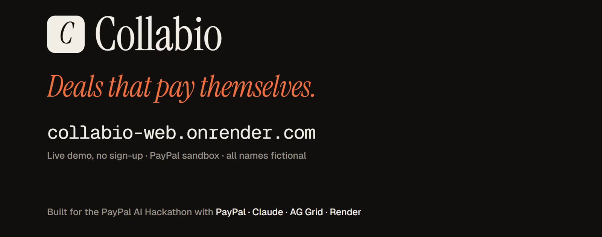
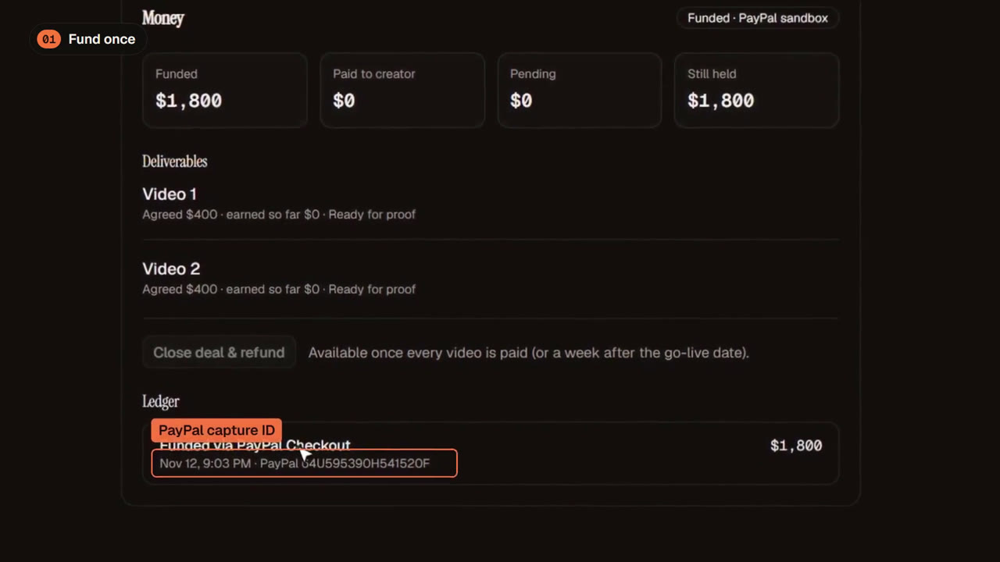
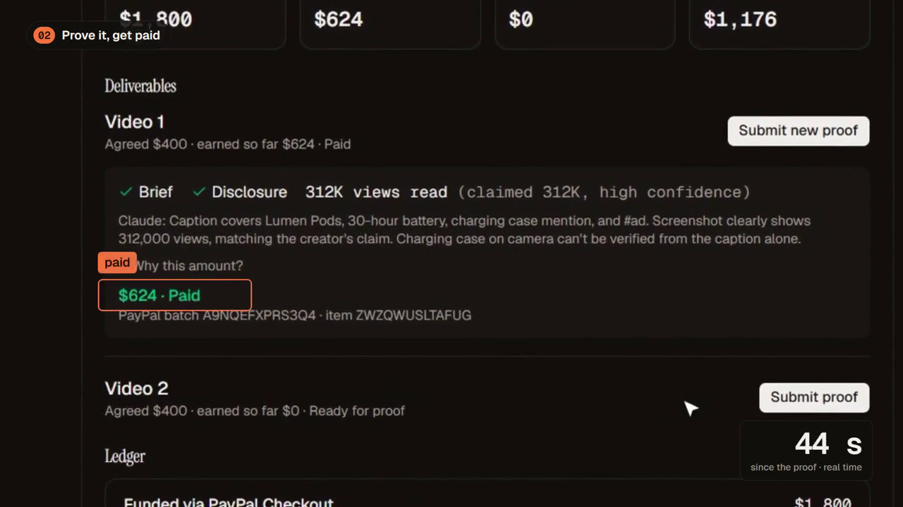
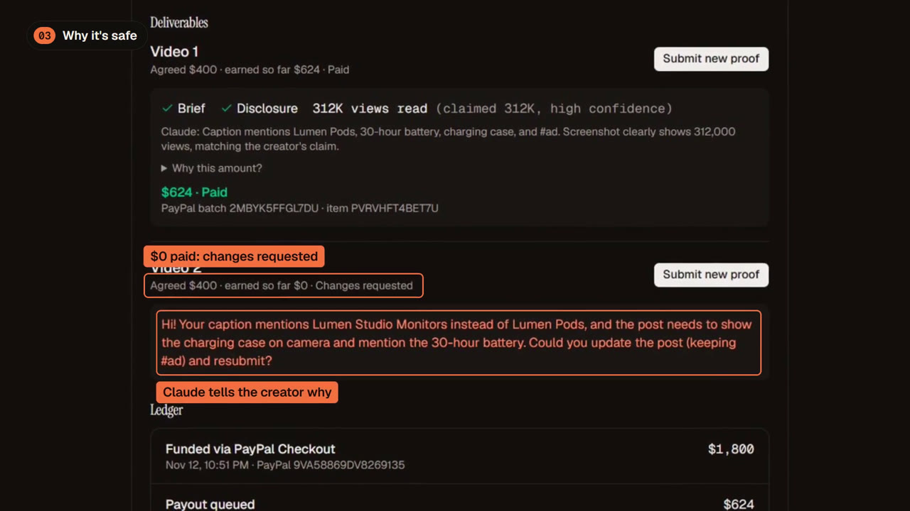
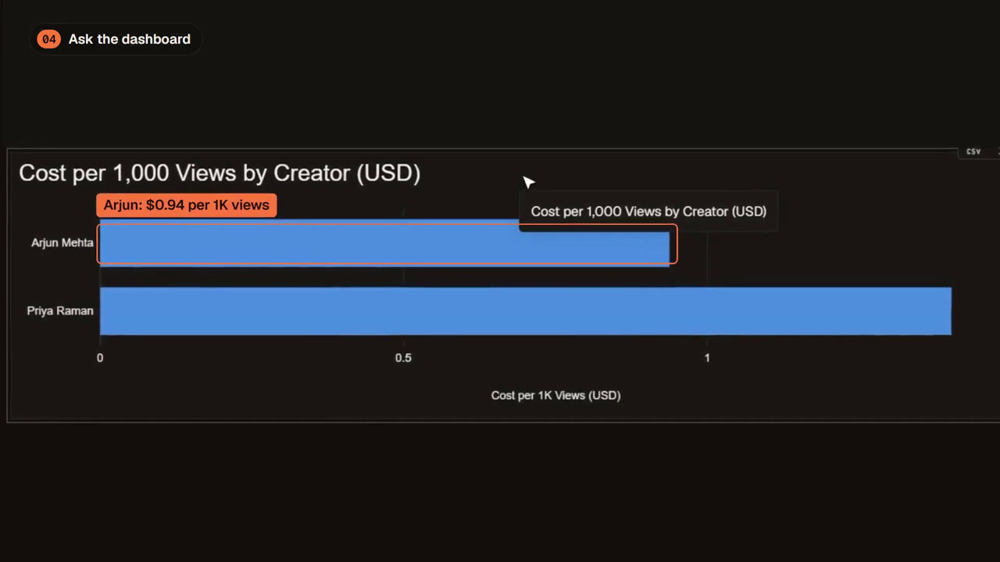
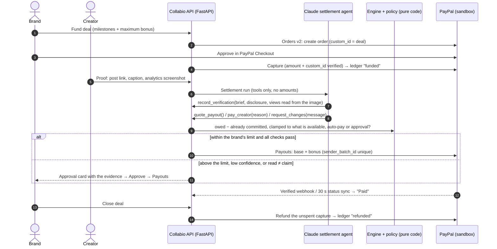

# Collabio: creator deals that pay themselves, on PayPal

[](https://youtu.be/0tdhkWARSKc)

**A brand funds a creator deal once with PayPal. A Claude agent checks each post, reads the views off the
creator's analytics screenshot, and pays the creator through PayPal Payouts: base pay plus a performance bonus,
within limits the brand sets. Unspent budget is refunded through PayPal when the deal closes. The model decides
*what happened*; code decides *what it is worth*.**

- **Demo video (2:30):** https://youtu.be/0tdhkWARSKc
- **Live demo (no sign-up, PayPal sandbox):** https://collabio-web.onrender.com
- **Architecture and technology deep dive:** [ARCHITECTURE.md](ARCHITECTURE.md)
- Built for the PayPal AI Hackathon (Oct 9 to Nov 12, 2026) with **PayPal**, **Claude (Anthropic)**,
  **AG Grid (AG Studio)** and **Render**. License: [MIT](LICENSE).

## The problem, and who it is for

Small consumer brands now run most of their marketing through creators, and they still pay them by hand.
A sponsorship deal carries view clauses, per-1,000-view (CPM) bonuses with caps, and bonus tiers. Someone has
to open every post, read the numbers off an analytics screenshot, work out what is owed and send the money.
Creators chase late payments; brands overpay or underpay.

In our interviews with **292 founders, 32 pay creators, and every one of them does the payment step by hand.**
The deal isn't the bottleneck. The payout is.

Collabio is a creator marketplace where a brand briefs, negotiates and books creators. This build adds the
missing half, **the money**, on PayPal: the deal is funded up front, an agent settles each video against the
agreed terms, and every movement is a real PayPal sandbox transaction in an append-only ledger.

## What it does (the demo, in four steps)

| Step | Who | What happens | PayPal | AI |
|---|---|---|---|---|
| 1. **Fund once** | Brand | Writes the bonus in plain words ("$2 per 1K views after 200K, up to $500 per video"); sees exactly what 100K / 500K / 1M views would pay; sets an auto-approve limit; funds the agreed price plus the maximum bonus. | **Orders v2**: create, buyer approval, capture | Claude Haiku parses the terms (structured output) |
| 2. **Prove it** | Creator | Submits the post link, the caption and an analytics screenshot. | | |
| 3. **Settle it** | Agent | Checks the brief and the #ad disclosure, reads the views from the screenshot, then pays within the brand's limit, or queues a one-click approval with the evidence, or requests changes and says why. | **Payouts** (+ verified webhooks and status sync) | Claude Sonnet agent with **vision** and **tools** |
| 4. **Close it** | Brand | Closes the deal; whatever the creator did not earn goes back. | **Refunds** against the capture | |
| + **Ask it** | Brand | The AG Studio money dashboard answers questions and builds charts ("Which creator gives me the cheapest 1,000 views? Add a chart."). | Every row carries its PayPal ID | Claude Sonnet inside **AG Studio** |

<table>
  <tr>
    <td width="50%"><br><sub><b>Fund once:</b> $1,800 captured through PayPal Checkout; the ledger keeps the PayPal capture ID.</sub></td>
    <td width="50%"><br><sub><b>Prove it, get paid:</b> Claude checks the brief and disclosure, reads 312K views off the screenshot; $624 paid via PayPal Payouts in under a minute.</sub></td>
  </tr>
  <tr>
    <td width="50%"><br><sub><b>Refuses safely:</b> a caption about the wrong product gets "changes requested" and a reason; $0 is paid.</sub></td>
    <td width="50%"><br><sub><b>Ask the dashboard:</b> the Claude agent in AG Studio builds a cost-per-1K-views chart on request.</sub></td>
  </tr>
</table>

## How money moves



**The model never supplies a money amount.** Its only money tool, `pay_creator`, takes a reason. Amounts come
from a pure, integer-cents engine (`backend/app/core/settlement.py`); whether a payout may go out on its own is
decided by a separate pure policy (`backend/app/core/payout_policy.py`): the brand's limit, a non-low
confidence, the view count read from the screenshot within 5% of the creator's claim, and the brief and
disclosure checks. Both run server-side, under row locks, not in the prompt.

## Try it (judge guide)

**Hosted app:** https://collabio-web.onrender.com *(Render, PayPal sandbox only: no real money. The first load
can take ~30 s.)* No sign-up and no keys.

1. **Enter as Lumen Audio (brand)** → **Booked** → **Lumen Pods**. Optionally type a bonus in plain words and
   click **Preview with Claude** → **Save bonus**, set **Auto-approve payouts up to**, then **Fund $… with PayPal**.
   PayPal sandbox buyer:
   - email: `sb-2tvbe53856800@personal.example.com`
   - password: `;d$39K7[`
2. **Persona** (left rail) → **Enter as Priya (creator)** → **Booked** → **Lumen Pods** → **Submit proof** on
   Video 1 → pick the **312K views** sample screenshot → **Submit for payout**.
3. Watch the verdict card: Claude checks the brief and the disclosure and reads the views; the engine computes
   what is owed; within the limit the agent pays through PayPal Payouts (Sent → Paid, usually under a minute).
   Try a caption about a different product on Video 2: Claude requests changes and nothing is paid.
4. Back as the brand: **Lumen Studio Monitors** has a $1,400 payout above the limit, waiting for **Approve
   payout**. When every video is paid, **Close deal & refund** returns the unspent budget as a PayPal refund.
   Every step is in the deal's **Ledger** with its PayPal ID.
5. **Money** (left rail): the AG Studio dashboard over all deals. **Edit dashboard** → ask the assistant, e.g.
   "Which creator gives me the cheapest 1,000 views? Add a chart."

Seeded history so the dashboard has something to compare: Studio Monitors (Priya, a payout awaiting approval),
and two deals with a second creator, Arjun Mehta (Desk Speaker, closed and refunded; Soundbar, one video paid on
1.5M views). Seeded rows use `SEED-` references instead of PayPal IDs. **Persona → Reset demo** restores
everything. All names, brands and screenshots are fictional.

## Technology at a glance

| Layer | What we use | Details |
|---|---|---|
| Payments | **PayPal REST APIs (sandbox)**: Orders v2, Payouts, Refunds, Webhooks, OAuth 2.0 | Direct `httpx` client with token cache, refresh on 401, retries with backoff, and a `PayPal-Request-Id` on every POST that is reused on retry |
| AI | **Claude Sonnet 5.5**: settlement agent (vision + strict tool use) and AG Studio dashboard agent · **Claude Haiku 5.5**: bonus-terms parser (JSON-schema structured output) | Anthropic Messages API from the backend (Python SDK) and a Next.js route (TypeScript SDK) |
| Dashboard | **AG Studio + AG Grid** (`ag-studio`, `ag-grid-react`) | Five linked data sources, KPI tiles, charts, grids, and an agent that edits the report |
| Hosting | **Render** Blueprint (`render.yaml`) | API + web services and a nightly cron in Singapore; a Render Workflows task package for settlement runs |
| App | Next.js 16 (App Router), React 19, TypeScript, Tailwind 4 · FastAPI (Python 3.12), asyncpg | Typed OpenAPI client between them |
| Data | Supabase: Postgres (row-level security, append-only ledger trigger), Auth, Realtime, Storage (proof screenshots) | |
| Build | Claude Code; APIMatic PayPal Server SDK context plugin (design review of retries and errors) | |

See [ARCHITECTURE.md](ARCHITECTURE.md) for every PayPal call, every Claude tool, the money invariants, the data
model and the deployment.

## Repository layout

```
backend/                FastAPI service
  app/adapters/         paypal.py (REST client), claude.py (Anthropic wrapper), supabase, gemini, ...
  app/agents/           settlement_agent.py (Claude tool loop), terms_parser.py (Claude structured output)
  app/core/             settlement.py (payout engine), payout_policy.py (auto-pay policy), caps.py
  app/modules/money/    service, repo, runner: funding, settlement runs, payouts, refunds, webhooks
  app/workers/          payout status sync loop (30 s)
  workflows/            Render Workflows tasks (settle_submission, nightly_settlement)
  supabase/migrations/  schema, including the M4 money tables and the append-only ledger trigger
  tests/                ~1,070 tests (unit, API, DB) + live PayPal sandbox tests (marker "live")
frontend/               Next.js app
  components/money/     bonus editor, fund-with-PayPal, proof dialog, verdict card, ledger
  components/money-dashboard/  AG Studio dashboard (sources, widgets, agent harness)
  lib/ai/claude-adapter.ts     AG Studio agent framework → Anthropic Messages API bridge
  app/api/ai/claude/route.ts   server route for the dashboard agent (model pinned, capped)
  tests/                ~840 tests (Vitest unit + Playwright e2e)
render.yaml             Render Blueprint (collabio-api, collabio-web, collabio-nightly)
```

## Run it locally

Requirements: Python 3.12 with [uv](https://docs.astral.sh/uv/), Node 22, a Supabase project, a PayPal sandbox
app (US business + personal sandbox accounts), and an Anthropic API key.

```bash
# Backend
cd backend
cp .env.example .env            # Supabase, PayPal sandbox, Anthropic, demo accounts
uv sync
uv run python -m scripts.seed_money       # demo deals for the brand persona
uv run uvicorn app.main:create_app --factory --port 8001

# Frontend (another terminal)
cd frontend
cp .env.example .env.local      # NEXT_PUBLIC_API_URL=http://localhost:8001
npm ci
npm run dev                     # http://localhost:3000
```

Tests: `cd backend && uv run pytest -q` (needs the database) and `cd frontend && npm run typecheck && npx vitest run`.
Live PayPal sandbox checks: `uv run pytest tests/live/test_paypal_sandbox.py -m live`.

## Public demo mode

`HACKATHON_MODE=1` (backend) and `NEXT_PUBLIC_HACKATHON_MODE=1` (frontend) switch on the public demo; nothing is
deleted, only flagged:

- persona buttons instead of sign-up (the demo password never reaches the browser);
- outbound phone calls off (`403 disabled_in_demo`) and no outbound email;
- daily caps per persona (60 settlement runs, 60 bonus previews, 80 assistant messages / 800 model calls) with
  per-IP sub-caps; a cap returns `429 demo_cap` with a friendly message;
- **Reset demo** reseeds the demo deals (at most once a minute).

## Honest limits and what's next

- Views are read from a screenshot, so a convincing fake under the brand's limit could still be paid. Today's
  mitigations: Claude's confidence, the 5% claim check, the brand's limit, human approval, and a $0 limit to
  review every payout. **Next:** read views from the platforms' analytics APIs.
- Next: Indian payment rails for Indian creators, a platform fee, and disputes.

The wider Collabio product (creator discovery, voice briefs, email and voice negotiation) uses Gemini and
ElevenLabs; in the public demo, phone calls and outbound email are switched off.

## License

[MIT](LICENSE)
