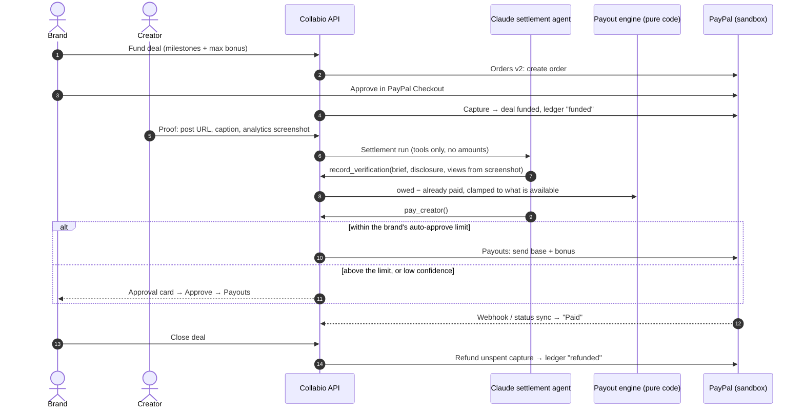

# Collabio: creator deals that pay themselves, on PayPal

**A brand funds a creator deal once with PayPal; a Claude agent checks each post, reads the views from
the analytics screenshot, and pays the creator through PayPal Payouts: base pay plus a performance
bonus, within limits the brand sets. Unspent budget is refunded when the deal closes.**

## The problem, and who it is for

Small consumer brands now run most of their marketing through creators, and they pay them by hand.
Deals carry view clauses, CPM bonuses with caps and bonus tiers; someone has to check every post,
read the numbers off a screenshot, work out what is owed and send the money. Creators chase late
payments; brands overpay or underpay. In interviews with 292 founders, 32 said they pay influencers,
and the payment step was manual every time.

Collabio is a marketplace where a brand briefs, negotiates and books creators (voice and email
agents already did that part). This build adds the missing half: **the money**. The deal is funded
up front, the agent settles each video against the agreed terms, and every movement is a real
PayPal sandbox transaction in an append-only ledger.

## Try it (judge guide)

**Hosted app:** https://collabio-web.onrender.com *(Render; PayPal sandbox only: no real money)*

No sign-up and no keys. The landing page has two buttons:

1. **Enter as Lumen Audio (brand)** → Deals → **Lumen Pods launch** → optionally add a bonus in plain
   English ("$2 per 1K views after 200K, up to $500 per video") → **Fund $… with PayPal**.
   Log in to the PayPal sandbox with the buyer account:
   - email: `sb-2tvbe53856800@personal.example.com`
   - password: `;d$39K7[`
2. Switch to **Priya (creator)** from the app menu → the same deal → **Submit proof** on video 1 →
   pick a sample analytics screenshot (e.g. 312,000 views) → submit.
3. Watch the verdict card: Claude checks the brief and the disclosure, reads the views from the
   screenshot, the engine computes what is owed, and the agent pays through PayPal Payouts
   (Pending → Paid). Payouts above the brand's auto-approve limit wait for the brand.
4. Switch back to the brand: **Approve payout** for any waiting payout, then **Close and refund** to return the
   unspent budget through a PayPal refund. Every step is in the deal's ledger with its PayPal id.
5. Open **Money** in the brand rail: an AG Studio dashboard over all of it. Click **Edit dashboard**
   and ask the assistant, for example, "Add a chart of effective cost per 1,000 views by creator".

Pre-seeded history, so the dashboard has something to compare: "Studio Monitors" (Priya; a
payout waiting for your approval), and two deals with a second creator, Arjun Mehta: "Desk
Speaker" (closed and refunded) and "Soundbar review" (one video paid on 1.5M views). **Reset
demo** in the app menu restores everything.

## How money moves



The model never supplies a money amount. Amounts come only from the deterministic engine
(`backend/app/core/settlement.py`), and auto-pay is decided only by
`backend/app/core/payout_policy.py`; both are enforced server-side, not by prompt. Paid out plus
refunded can never exceed what was captured.

## Where PayPal is used

| PayPal API | What Collabio does with it |
|---|---|
| **Orders v2** (create, capture) | The brand funds a deal with PayPal wallet checkout; capture verifies the amount and `custom_id`, and a double click or retry never captures twice. |
| **Payouts** | The agent (or the brand, on approval) pays each video's base pay and bonus to the creator; `sender_batch_id` is unique per payout so a retry is never a second payment. |
| **Refunds** | Closing a deal refunds `captured − paid or pending − refunded` against the capture. |
| **Webhooks** | `PAYMENT.PAYOUTS-ITEM.*` and `PAYMENT.CAPTURE.REFUNDED`, verified with `verify-webhook-signature`; a worker also polls payout batches so status converges either way. |

OAuth tokens come from the client id and secret and refresh automatically. Every POST carries a
`PayPal-Request-Id` that is reused on retry, so a timeout whose outcome is unknown is replayed, not
repeated.

## Where AI is used

- **Claude settlement agent** (`claude-sonnet-5-5`, vision + tool use): verifies the brief and the
  disclosure, reads the view count from the analytics screenshot, and calls `pay_creator`, the only
  way money moves. Low confidence, or a read more than 5% from the creator's claim, goes to the brand.
- **Claude terms parser** (`claude-haiku-5-5`, structured output): turns "$2 per 1K views after 200K,
  up to $500" into validated `BonusTerms`, with worked examples before the brand funds.
- **Claude AG Studio agent** (`claude-sonnet-5-5`): the "Ask Collabio" assistant on the money
  dashboard answers questions and builds widgets through AG Studio's agent framework, via a custom
  Anthropic adapter (`frontend/lib/ai/claude-adapter.ts`).
- Existing Collabio features: **Gemini** for creator search and ranking, **ElevenLabs** voice for
  briefs (phone calls are switched off in the public demo).

## Sponsor tools

- **AG Grid**: AG Studio renders the brand's money dashboard (KPIs, charts, the deals grid), and the
  AG Studio agent framework runs the Claude assistant that edits it.
- **Render**: the API, the web app and a nightly settlement cron run on Render from `render.yaml`
  (see `docs/deploy.md`). Settlement runs are also packaged as a **Render Workflows** service
  (`backend/workflows/settlement.py`: `settle_submission`, `nightly_settlement`); the API starts
  them there when `RENDER_WORKFLOWS_ENABLED=1` and falls back to running in-process otherwise.
- **APIMatic**: the PayPal Server SDK Context Plugin (APIMatic-generated skills) was installed in the
  coding agent while building and used to review the PayPal integration's retry and error-handling
  design against the generated SDK's documented semantics. The backend itself calls the PayPal REST
  API directly with `httpx`.

## Architecture

See [`docs/architecture.md`](docs/architecture.md). In short: Next.js 16 (App Router) → FastAPI →
PayPal sandbox, Anthropic, Supabase (Postgres, Auth, Storage), all hosted on Render.

## Run it locally

Requirements: Python 3.12 with [uv](https://docs.astral.sh/uv/), Node 22, a Supabase project,
a PayPal sandbox app, and an Anthropic API key.

```bash
# Backend
cd backend
cp .env.example .env            # fill in Supabase, PayPal sandbox, Anthropic, demo accounts
uv sync
uv run python -m scripts.seed_money       # demo deals for the brand persona
uv run uvicorn app.main:create_app --factory --port 8001

# Frontend (another terminal)
cd frontend
cp .env.example .env.local      # NEXT_PUBLIC_API_URL=http://localhost:8001
npm ci
npm run dev                     # http://localhost:3000
```

Tests: `cd backend && uv run pytest -q` (needs the database) and
`cd frontend && npm run typecheck && npx vitest run`.
Live sandbox checks: `uv run pytest tests/live/test_paypal_sandbox.py -m live`.

## Hackathon mode

`HACKATHON_MODE=1` (backend) and `NEXT_PUBLIC_HACKATHON_MODE=1` (frontend) switch on the public-demo
behaviour; nothing is deleted, only flagged:

- persona buttons instead of sign-up; the demo password never reaches the browser;
- outbound phone calls are off (`403 disabled_in_demo`); typing and browser voice still work;
- daily caps per user: 30 settlement runs, 40 assistant messages (400 model calls), 30 bonus
  previews, 15 voice sessions; a cap returns `429 demo_cap` with a friendly message;
- **Reset demo** reseeds the demo deals (once a minute at most).

All names, brands and analytics screenshots in the demo are fictional.

## License

[MIT](LICENSE)
