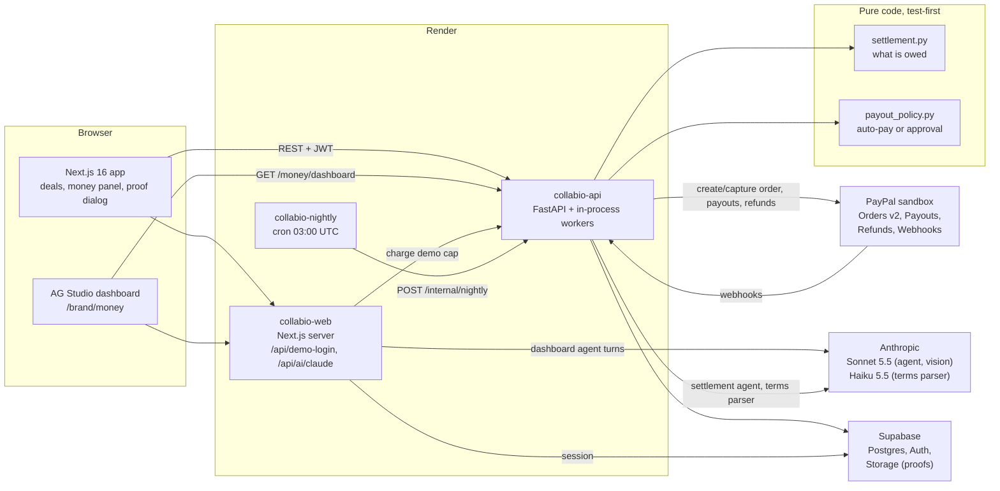

# Architecture (PayPal hackathon build)

## Pieces

| Piece | Where | What it does |
|---|---|---|
| Payout engine | `backend/app/core/settlement.py` | Pure, integer-cents maths: bonus for views, funding total, what is owed per video, the payable delta clamped to what is available, the refund. Table-driven tests. |
| Payout policy | `backend/app/core/payout_policy.py` | Pure decision: auto-pay only when checks pass, confidence is high, the read is within 5% of the claim, and the amount is within the brand's limit; otherwise approval. |
| PayPal adapter | `backend/app/adapters/paypal.py` | OAuth token cache with refresh-on-401, `PayPal-Request-Id` reused across retries, capture with `return=representation`, payouts, refunds, webhook verification. |
| Settlement agent | `backend/app/agents/settlement_agent.py` | Claude tool-use loop (≤ 8 steps): `get_deal_context`, `record_verification`, `pay_creator`. The model never passes an amount; `pay_creator` asks the engine and the policy. |
| Runner and workers | `backend/app/modules/money/` | One run per submission (unique), claimed with a lock; stale runs reclaimed; payout status synced by worker and webhook; nightly sweep. |
| Money ledger | `money_events` table | Append-only (a trigger blocks updates); every funding, payout and refund with its PayPal id. |
| Dashboard | `frontend/components/money-dashboard/` | AG Studio data sources over flat rows from `GET /money/dashboard`, a default report, and the "Ask Collabio" agent through `frontend/lib/ai/claude-adapter.ts` → `/api/ai/claude`. |
| Hackathon mode | `HACKATHON_MODE`, `NEXT_PUBLIC_HACKATHON_MODE` | Persona sign-in, calls off, daily caps, demo reset. Flags, not deletions. |

## Money invariants

- Amounts are integer cents in USD; rounding is floor.
- `paid or pending + refunded ≤ captured`, per deal.
- One capture per funding (double clicks and retries return the existing capture).
- One payout per (milestone, delta): the milestone row is locked during quote and pay, and
  `sender_batch_id` is unique.
- After close, payouts are rejected with `409 deal_closed`.
